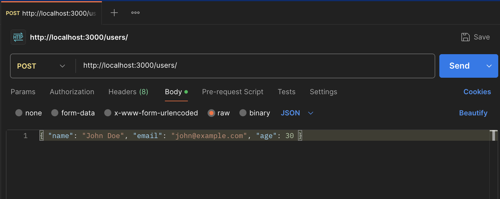
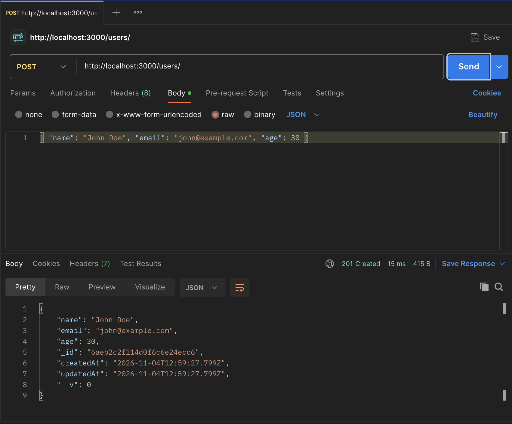
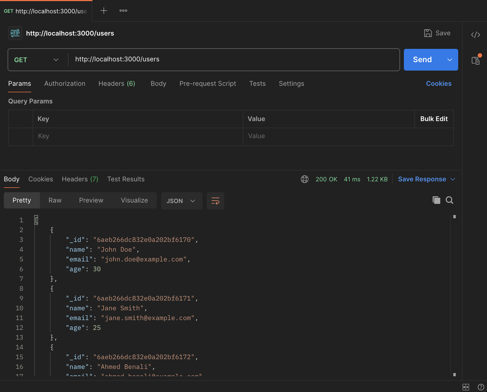
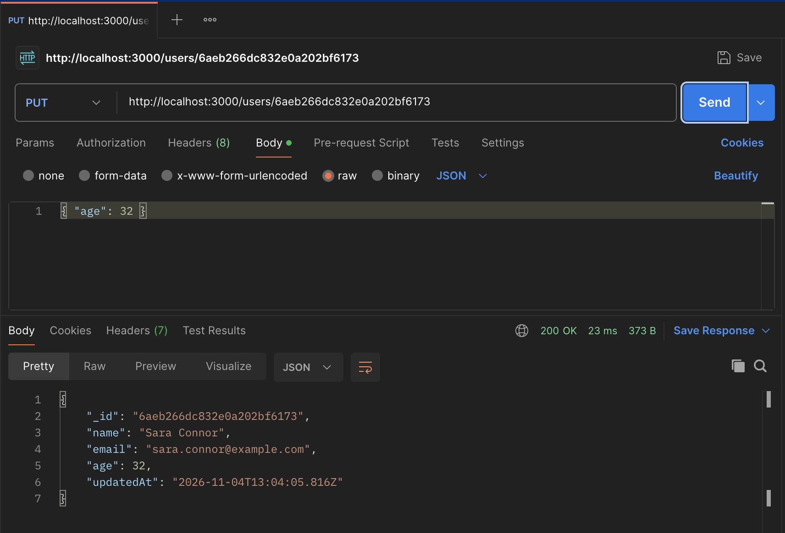
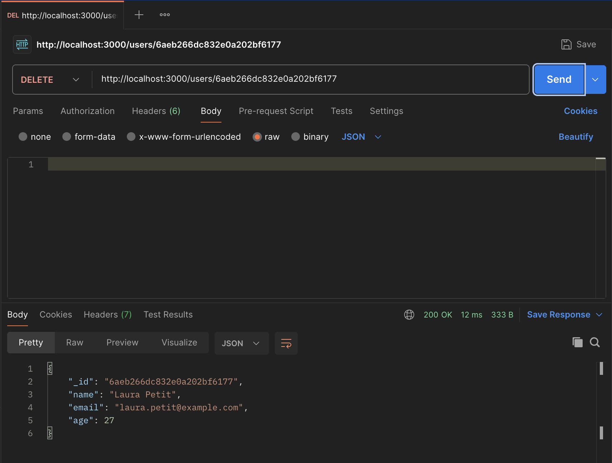

# 📘 REST API Testing Report — Mongoose Users API

> **Project:** CRUD REST API with Express & Mongoose
> **Database:** MongoDB — `mongodb://localhost:27017/user_db`
> **Testing tool:** Postman
> **Date:** November 4, 2026

---

## 1. Objective

The goal of this project was to build a REST API that manipulates a MongoDB
database with **Mongoose**, then test every route with **Postman**. The API
manages a `users` collection through four CRUD routes: **GET**, **POST**,
**PUT** and **DELETE**.

## 2. Tech Stack

| Technology | Role |
|------------|------|
| **Node.js** | JavaScript runtime |
| **Express** | HTTP server & routing |
| **Mongoose** | MongoDB ODM (schema, model, queries) |
| **dotenv** | Environment variables (`config/.env`) |
| **MongoDB** | Database (`user_db` on `localhost:27017`) |
| **Postman** | API testing |

## 3. Project Structure

```
mongoose-users-api/
├── config/
│   └── .env              ← PORT=3000, MONGO_URI (localhost:27017/user_db)
├── models/
│   └── User.js           ← Mongoose Schema + exported User model
├── postman_screenshots/  ← Postman test evidence (this report)
├── server.js             ← Express server + the 4 routes
└── package.json
```

## 4. API Endpoints

| # | Method | Endpoint | Description | Mongoose method |
|---|--------|----------|-------------|-----------------|
| 1 | `POST` | `/users` | Add a new user | `User.create()` |
| 2 | `GET` | `/users` | Return all users | `User.find()` |
| 3 | `PUT` | `/users/:id` | Edit a user by id | `User.findByIdAndUpdate()` |
| 4 | `DELETE` | `/users/:id` | Remove a user by id | `User.findByIdAndDelete()` |

**Base URL:** `http://localhost:3000`

---

## 5. Test Results

### 5.1 — `POST /users` : Add a new user

**Request**

- **Method:** `POST`
- **URL:** `http://localhost:3000/users/`
- **Body** (raw → JSON):

```json
{ "name": "John Doe", "email": "john@example.com", "age": 30 }
```



**Response — `201 Created` (15 ms, 415 B)**



```json
{
    "name": "John Doe",
    "email": "john@example.com",
    "age": 30,
    "_id": "6aeb2c2f114d0f6c6e24ecc6",
    "createdAt": "2026-11-04T12:59:27.799Z",
    "updatedAt": "2026-11-04T12:59:27.799Z",
    "__v": 0
}
```

**Analysis**

- ✅ Status **`201 Created`** — the resource was successfully created.
- ✅ MongoDB generated the unique identifier `_id: 6aeb2c2f114d0f6c6e24ecc6`.
- ✅ `createdAt` and `updatedAt` are identical → the document has just been
  created and never modified (added automatically by the schema's
  `timestamps: true` option).
- ✅ `__v: 0` is Mongoose's internal **version key** (used for optimistic
  concurrency control) — version `0` means "saved once, never updated".
- 💡 This `_id` is used in the PUT / DELETE tests below.

---

### 5.2 — `GET /users` : Return all users

**Request**

- **Method:** `GET`
- **URL:** `http://localhost:3000/users`
- **Body:** none

**Response — `200 OK` (41 ms, 1.22 KB)**



```json
[
    {
        "_id": "6aeb266dc832e0a202bf6170",
        "name": "John Doe",
        "email": "john.doe@example.com",
        "age": 30
    },
    {
        "_id": "6aeb266dc832e0a202bf6171",
        "name": "Jane Smith",
        "email": "jane.smith@example.com",
        "age": 25
    },
    {
        "_id": "6aeb266dc832e0a202bf6172",
        "name": "Ahmed Benali",
        "email": "ahmed.benali@example.com",
        "age": 32
    }
    // ... remaining dummy users
]
```

**Analysis**

- ✅ Status **`200 OK`** — the request succeeded.
- ✅ The response is a **JSON array** containing every document of the
  `user_db.users` collection (the dummy dataset inserted directly in MongoDB,
  visible through the API).
- ✅ `User.find()` with no filter returns the full collection — the payload
  size (1.22 KB) reflects the multiple documents returned.

---

### 5.3 — `PUT /users/:id` : Edit a user by id

**Request**

- **Method:** `PUT`
- **URL:** `http://localhost:3000/users/6aeb266dc832e0a202bf6173`
- **Body** (raw → JSON):

```json
{ "age": 32 }
```

**Response — `200 OK` (23 ms, 373 B)**



```json
{
    "_id": "6aeb266dc832e0a202bf6173",
    "name": "Sara Connor",
    "email": "sara.connor@example.com",
    "age": 32,
    "updatedAt": "2026-11-04T13:04:05.816Z"
}
```

**Analysis**

- ✅ Status **`200 OK`** — the user **Sara Connor** was found and updated.
- ✅ `age` changed from **28 → 32** — only the field sent in the body was
  modified; `name` and `email` are untouched (partial update).
- ✅ `User.findByIdAndUpdate(id, body, { new: true })` returns the **updated**
  document (not the original one).
- ✅ `updatedAt` was refreshed to `13:04:05` automatically by the
  `timestamps: true` schema option, while `createdAt` stays untouched.
- 💡 Calling the same route with an unknown id returns
  `404 { "message": "User not found" }`.

---

### 5.4 — `DELETE /users/:id` : Remove a user by id

**Request**

- **Method:** `DELETE`
- **URL:** `http://localhost:3000/users/6aeb266dc832e0a202bf6177`
- **Body:** none

**Response — `200 OK` (12 ms, 333 B)**



```json
{
    "_id": "6aeb266dc832e0a202bf6177",
    "name": "Laura Petit",
    "email": "laura.petit@example.com",
    "age": 27
}
```

**Analysis**

- ✅ Status **`200 OK`** — the user **Laura Petit** was found and removed.
- ✅ `User.findByIdAndDelete(id)` returns the **deleted document**, which is
  useful as proof of exactly what was removed from the collection.
- ✅ A following `GET /users` no longer contains this `_id`
  (`6aeb266dc832e0a202bf6177`).
- 💡 Calling the same route with an unknown id returns
  `404 { "message": "User not found" }`.

---

## 6. Response Fields Explained

| Field | Meaning |
|-------|---------|
| `_id` | Unique MongoDB identifier (ObjectId, 24 hex chars), generated automatically |
| `name` | User's name (`String`, required) |
| `email` | User's email (`String`, required, **unique**, lowercased) |
| `age` | User's age (`Number`, default `0`, minimum `0`) |
| `createdAt` | Creation timestamp — added by the schema's `timestamps: true` |
| `updatedAt` | Last-modification timestamp — refreshed on every update |
| `__v` | Mongoose **version key** — internal counter for concurrency control (`0` = never modified) |

## 7. Test Summary

| Route | Method | Tested | Status | Result |
|-------|--------|--------|--------|--------|
| `/users` | POST | ✅ | `201 Created` | User created with generated `_id` |
| `/users` | GET | ✅ | `200 OK` | All users returned as a JSON array |
| `/users/:id` | PUT | ✅ | `200 OK` | Sara Connor's age updated (28 → 32) |
| `/users/:id` | DELETE | ✅ | `200 OK` | Laura Petit removed from the database |

## 8. Conclusion

All four CRUD routes were tested successfully in Postman against the local
MongoDB database `user_db`:

- **POST** creates a document (`201`) and returns it with its generated `_id`.
- **GET** lists the whole collection (`200`).
- **PUT** partially edits a document by id (`200`) and refreshes `updatedAt`.
- **DELETE** removes a document by id (`200`) and returns the removed record.

The API correctly handles errors as well: unknown ids return `404`, invalid
payloads (e.g. missing required fields or a duplicate email) return `400` with
a descriptive message. The Mongoose schema validators (`required`, `unique`,
`min`) and the `timestamps` option make the data consistent and easy to audit.

---

*Report generated from the Postman screenshots in `postman_screenshots/`.*